## 01 / About

Desenvolvedor e profissional de TI. Construo sistemas, integro APIs e automatizo processos para resolver problemas reais em ambientes corporativos. Meu trabalho conecta desenvolvimento de software, infraestrutura e operações.

Atualmente, também aprofundo meus conhecimentos em redes e segurança da informação.

## 02 / Engineering toolkit

| Área | Tecnologias |
| :--- | :--- |
| Front-end |  |
| Back-end |  |
| Data |  · Oracle |
| Infrastructure |  · Windows Server |

## 03 / Selected work

| Projeto | Solução |
| :--- | :--- |
| **ERP / Sistema de Gestão** | Sistemas empresariais, integração de dados e automação de operações. `React` `TypeScript` `FastAPI` `PostgreSQL` |
| **SMTP Tester Pro** | Diagnóstico de conectividade, autenticação e serviços de e-mail. `Java` `Swing` `SMTP` `OAuth` |
| **PromoNet** | Processamento de ofertas e integrações com serviços externos. `Spring Boot` `RabbitMQ` `Redis` |
| **Corporate IT Tools** | Monitoramento de serviços, impressão corporativa e automação de infraestrutura. `Python` `PowerShell` `Windows` |

[Explore os repositórios públicos →](https://github.com/CassianoMeneghetti?tab=repositories)

## 04 / Development activity

---

`BUILD SYSTEMS  /  CONNECT IDEAS  /  KEEP LEARNING`

