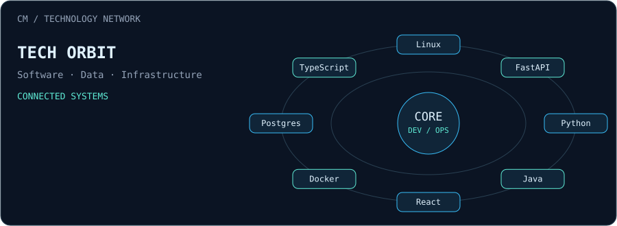
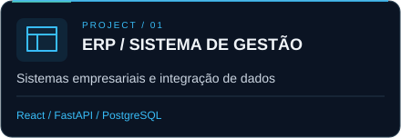
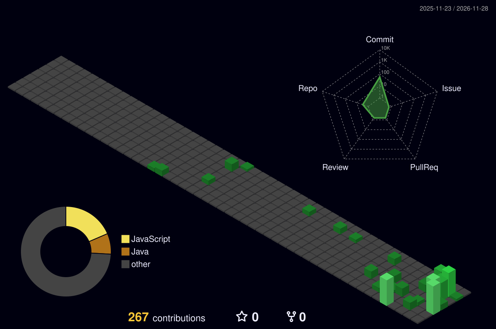

**Uma série sobre um desenvolvedor, seus servidores e os bugs que se recusam a morrer.**

## 🍿 Episódio piloto — Quem é esse cara?

Desenvolvedor e profissional de TI. Construo sistemas, integro APIs, automatizo processos e trabalho com infraestrutura. Atualmente estudo redes e segurança da informação.

Minha rotina, em versão sitcom: resolvo problemas que ninguém sabe explicar, automatizo tarefas para não precisar fazê-las duas vezes e ocasionalmente descubro que o bug era uma configuração.

## 🎭 Elenco principal — As tecnologias

| Área | Tecnologias |
| :--- | :--- |
| Front-end |  |
| Back-end |  |
| Data |  · Oracle |
| Infrastructure |  · Windows Server |

## 🎬 Outras produções do estúdio

[Explore os repositórios públicos →](https://github.com/CassianoMeneghetti?tab=repositories)

## 🦖 Episódio especial — Corrida contra o legado

## 📈 Audiência — Estatísticas reais do GitHub

## 🕹️ Intervalo comercial — Pac-Man

<picture>
  <source media="(prefers-color-scheme: dark)" srcset="./assets/contributions/pacman-contribution-graph-dark.svg"/>
  <source media="(prefers-color-scheme: light)" srcset="./assets/contributions/pacman-contribution-graph.svg"/>
  
</picture>

## 🏙️ Cidade dos commits

Visualizações atualizadas diariamente via GitHub Actions · [Pac-Man](https://github.com/abozanona/pacman-contribution-graph) · [3D contributions](https://github.com/yoshi389111/github-profile-3d-contrib)

---

**Fim do episódio.** Nenhum servidor foi ferido durante a produção desta comédia.

`Continua no próximo commit...`

