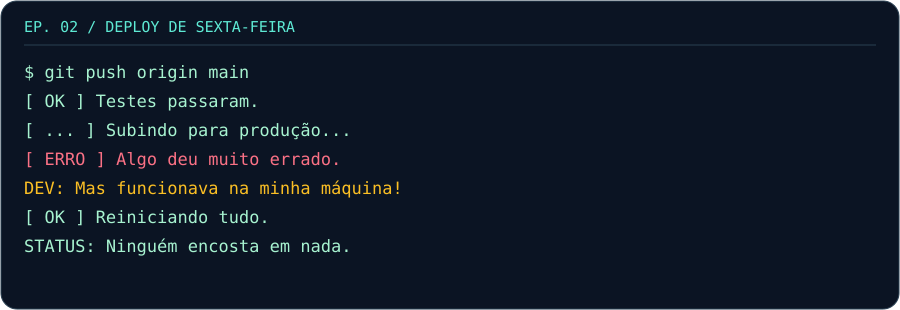
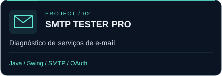
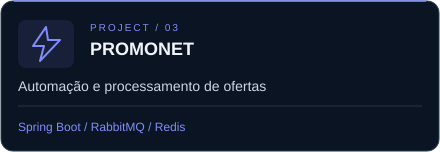
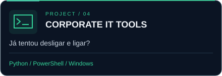

**🚨 ATENÇÃO: este perfil foi homologado pelo instituto Tirei da Minha Cabeça.**

Uma série sobre um desenvolvedor, seus servidores e os bugs que se recusam a morrer.

  

## 🤡 Quem autorizou esse cidadão a mexer no servidor?

Desenvolvedor e profissional de TI. Construo sistemas, integro APIs, automatizo processos e trabalho com infraestrutura. Atualmente estudo redes e segurança da informação.

Minha rotina, em versão sitcom: resolvo problemas que ninguém sabe explicar, automatizo tarefas para não precisar fazê-las duas vezes e ocasionalmente descubro que o bug era uma configuração.

## 📺 Plantão da TI

## 🎭 Elenco principal — A turma do barulho

| Área | Cúmplices |
| :--- | :--- |
| Front-end: centralizar uma div |  |
| Back-end: culpa do front |  |
| Banco: cadê o WHERE? |  · Oracle |
| Infra: reinicia que resolve |  · Windows Server |

## 🐱 Meu supervisor técnico

## 🎬 Projetos que inexplicavelmente funcionam

[Explore os repositórios públicos →](https://github.com/CassianoMeneghetti?tab=repositories)

## 🖨️ Boss final — Impressora corporativa

## 💀 SQL: o filme de terror

## 🦖 Corrida contra o legado — CLT Simulator

## 📈 Evidências de que eu trabalho (estatísticas reais)

## 🕹️ Pac-Man — terceirizei a tarefa de comer commits

<picture>
  <source media="(prefers-color-scheme: dark)" srcset="./assets/contributions/pacman-contribution-graph-dark.svg"/>
  <source media="(prefers-color-scheme: light)" srcset="./assets/contributions/pacman-contribution-graph.svg"/>
  
</picture>

## 🏙️ Minha cidade no SimCity dos commits

Visualizações atualizadas diariamente via GitHub Actions · [Pac-Man](https://github.com/abozanona/pacman-contribution-graph) · [3D contributions](https://github.com/yoshi389111/github-profile-3d-contrib)

---

**Fim do expediente (mentira, chegou outro chamado).**

Nenhum servidor foi ferido durante esta comédia. Os memes e incidentes são fictícios.

Se chegou até aqui, abra um chamado. Prazo estimado: assim que o café ficar pronto.

`Continua no próximo commit...`

